# better-codex

[English](README.md) · **Español**

[](https://github.com/MarioACo/better-codex/actions/workflows/test.yml)
[](https://github.com/MarioACo/better-codex/actions/workflows/codex.yml)
[](LICENSE)


Hooks, skills y métricas para que usar [OpenAI Codex](https://developers.openai.com/codex) salga más barato, dé mejores respuestas y sea más seguro.

- **Gasta menos tokens.** Codex arranca cada sesión sabiendo cómo es tu repo, no lee completos los lockfiles, la salida de build ni `node_modules`, y te avisa antes de que una sesión se vuelva cara.
- **Responde mejor.** Cada prompt recibe una guía corta para su tipo de tarea, los archivos que mencionas se resuelven a rutas reales, y Codex no termina sin verificar el código que cambió.
- **Es más seguro.** Antes de algo destructivo (borrar archivos, descartar cambios sin commit, `push --force`, `DROP TABLE`, deploys, secretos), Codex se detiene y te dice qué quiere ejecutar, por qué, qué se puede perder y qué alternativa más segura hay. Solo sigue si respondes que sí.

Todo corre en tu máquina, sin dependencias y sin conexiones a internet. Inspirado en [better-claude](https://github.com/midudev/better-claude).

## Así se ve

<p align="center">
  
</p>

<p align="center"><sub>Resumen de una sesión real (Codex 0.164, extensión de VS Code, Windows).</sub></p>

El repo tiene una carpeta con un archivo que nunca se subió a git. Codex la revisa, explica qué se perdería, sugiere un respaldo y pregunta. Tu «sí» cubre el comando exacto que te mostró, una vez. Cuando después intentó otra cosa, borrar con la ruta en una variable (`$target`), el guard lo detuvo, y Codex tuvo que volver a preguntar con el comando exacto.

## Por qué

Medido en 34 sesiones reales de Codex (`bcx stats`): **7 sesiones que pasaron del 70% de la ventana de contexto se llevaron el 79% de todos los tokens de entrada.** Cada petición reenvía la conversación completa, así que una sesión larga cuesta más en cada turno y sus respuestas empeoran.

En esas mismas sesiones, de 3,331 llamadas a herramientas, el guard habría pedido confirmación 34 veces (1%, `bcx audit`):

- 25 borrados;
- 6 cambios de configuración global;
- 2 cambios al historial de git (un `push --force-with-lease` a main y el borrado de un tag remoto);
- 1 lectura de credenciales.

Uno de los cambios globales fue `git config --global user.email …`. Codex lo ejecutó sin preguntar y reemplazó la identidad de git que usaban todos los demás repos de esa máquina. better-codex casi no interrumpe, y cuando lo hace es por acciones como esa.

Y **el 27% de toda la entrada se fue en esperar**: 1,238 peticiones cuyo único trabajo era preguntar si un build, unos tests o una compilación de Gradle ya habían terminado. Cada una reenvió la conversación completa.

## Empieza en un minuto

Necesitas Node 20+ y Codex con hooks: el CLI, la extensión de VS Code o la app de escritorio.

```bash
git clone https://github.com/MarioACo/better-codex
cd better-codex
node bin/bcx.js install --dry-run   # muestra qué cambiaría, sin escribir nada
node bin/bcx.js install
```

**Después, el paso que solo puedes hacer tú: aprobar los hooks.**

1. Abre el CLI de Codex. `install` te imprime el comando exacto para tu máquina.
2. Escribe `/hooks`. Los 5 hooks de better-codex aparecen como pendientes de revisión.
3. Confía en cada uno.

Codex nunca ejecuta hooks que no aprobaste, y si cambian te los vuelve a pedir. La app de escritorio, la extensión de VS Code y `codex exec` se saltan los hooks no aprobados **sin avisar**, así que no te saltes este paso.

Por último, comprueba que Codex los está ejecutando:

```bash
node bin/bcx.js doctor   # «Lo que Codex ha enviado de verdad» debe mostrar tus eventos recientes
```

<details>
<summary>¿Solo tienes la app de escritorio o la extensión de VS Code?</summary>

Las dos traen un CLI de Codex, pero no está en tu `PATH`. Ábrelo de alguna de estas formas:

```powershell
# El CLI que trae la app de escritorio necesita --no-daemon
# (si no: «this CLI has no complete local package»)
& "$env:USERPROFILE\.codex\.sandbox-bin\codex.exe" --no-daemon   # Windows
~/.codex/.sandbox-bin/codex --no-daemon                          # macOS / Linux

# La extensión de VS Code trae un CLI completo
~/.vscode/extensions/openai.chatgpt-<versión>-<plataforma>/bin/<plataforma>/codex
```

</details>

`install` hace esto, con un respaldo previo de cada archivo que toca en `~/.codex/better-codex/backups/`:

- **Copia better-codex a `~/.codex/better-codex/app/`.** Los hooks corren desde esa copia, así que puedes mover o borrar el clon, o cambiar de versión de Node, y siguen funcionando.
- **Agrega 5 hooks a `~/.codex/hooks.json`.** Los tuyos se quedan como están.
- **Agrega un bloque delimitado de reglas al final de `~/.codex/AGENTS.md`.**
- **Registra el marketplace e instala el plugin `bcx`** (4 skills).

Para actualizar: `git pull` y luego `node bin/bcx.js install` otra vez. Mientras `hooks.json` no cambie, Codex no te pide aprobar los hooks de nuevo. Para tener un comando `bcx` que funcione desde cualquier carpeta, ejecuta `npm link` dentro del repo.

## Dónde funciona

better-codex vive en `~/.codex` (hooks, reglas y skills), y todo Codex local lee esa carpeta. Por eso funciona en cualquier Codex que corra en tu máquina:

| Codex | Funciona | Notas |
| --- | --- | --- |
| CLI (`codex`, `codex exec`) | ✓ | Verificado en vivo con Codex 0.164 en Windows. |
| Extensión de VS Code | ✓ | Mismo motor y misma `~/.codex`. `install` también encuentra el CLI que trae dentro, así que puedes aprobar los hooks desde ahí. |
| Cursor, Windsurf, VS Code Insiders | ✓ | Usan la misma extensión de OpenAI. |
| App de escritorio | ✓ | Mismo motor y misma `~/.codex`. |
| Codex dentro de WSL | ✓, por separado | WSL tiene su propia carpeta de usuario: instala better-codex también dentro de WSL. |
| Codex Cloud (tareas en la nube) | ✗ | Corre en los servidores de OpenAI y nunca lee tu `~/.codex`. |

Los hooks solo corren después de aprobarlos una vez en `/hooks`. Hasta entonces, todos se los saltan sin avisar.

**Linux y macOS:** cada semana, y con cada cambio, la CI instala el Codex real (la versión probada y la más reciente) en Linux, macOS y Windows, y comprueba que carga las reglas, los skills y los cinco hooks, y que cada hook corre en las terminales de ese sistema ([scripts/codex-compat.mjs](scripts/codex-compat.mjs)). Si lo usas en una Mac, la salida de `bcx doctor` en un issue ayuda mucho.

## Qué hace

| Momento | Función | Qué hace |
| --- | --- | --- |
| Al iniciar sesión | **brief** | Le da a Codex la rama, los cambios sin commit, el stack, los comandos de test/lint/build y la estructura del repo en ~100–350 tokens, lo que de otro modo gastaría en llamadas para averiguarlo. También cubre las particularidades de tu terminal: en Windows le dice que use `npm.cmd`, porque PowerShell suele bloquear `npm.ps1`, y le avisa si `rg` no está instalado. También lista los comandos que fueron lentos en este repo la última vez. El brief vuelve a llegar después de `/compact`. |
| Cada prompt | **boost** | Aplica los modos de abajo, agrega una guía corta según el tipo de tarea (bug, feature, refactor, tests, review, rendimiento, docs, pregunta; en español e inglés; una vez por sesión) y resuelve los archivos que nombras (`login`, `ReportTable`, `format.ts:12`) a rutas reales. |
| Antes de cada comando | **guard** | Detiene acciones destructivas o difíciles de deshacer hasta que las apruebes. Ver [Seguridad](#seguridad). |
| Antes de cada comando | **diet** | Evita leer completos lockfiles grandes, salida de build, binarios y archivos de más de 200 KB, y listados recursivos que recorrerían `node_modules`. Le dice a Codex cómo leerlos en su lugar (`rg -n`, rangos de líneas). |
| Después de cada comando | **comandos lentos** | Mide cada comando. Si uno tardó más de 30 s, se lo señala a Codex una vez y lo recuerda para ese repo, así la siguiente vez Codex lo corre y lo espera dentro de una sola llamada en vez de preguntar a cada rato. En vivo, con unos tests de 75 s: 5 peticiones bajaron a 2, y los tokens de entrada, un 60%. |
| Después de cada comando | **big output** | Si una salida fue enorme (más de 48 KB), le recuerda a Codex acotar sus siguientes búsquedas. |
| Antes de terminar | **verify gate** | Si Codex cambió código y no corrió ninguna verificación después de su último cambio, lo regresa una vez a ejecutar `npm test` (o lo que use tu proyecto). Si la última verificación **falló** y Codex va a terminar sin decirlo, lo regresa a arreglarla o a decir claramente que falla. Reconoce el fallo en la salida de node:test, Jest, Vitest, Mocha, pytest, Go, Cargo, tsc, ESLint, Gradle, Maven, .NET, Karma, Angular y npm. |
| Antes de terminar | **meter** | Te avisa debajo de la respuesta cuando el contexto pasa del 60% (`/compact`) o del 80% (`$bcx:handoff` y sesión nueva), y cuando tus límites de 5 horas o semanal pasan del 75%. |

### Modos de prompt

| Escribe | Qué pasa |
| --- | --- |
| `+arregla el login` o `profundo: …` | Investiga antes de editar, considera casos borde, verifica a fondo. |
| `rapido: …` | El cambio mínimo, sin explorar de más, y una respuesta de máximo 5 líneas. |
| `pregunta: …` | Solo responde: no edita archivos ni hace cambios. |
| `plan: …` | Un plan numerado (archivos, riesgos, verificación), y espera tu visto bueno. |

Los prefijos en inglés también funcionan: `deep:`, `quick:`, `ask:`.

### Skills (plugin `bcx`)

| Skill | Para qué |
| --- | --- |
| `$bcx:commit` | Divide tus cambios en Conventional Commits por tema y luego hace push, solo commit o una rama nueva. Nunca agrega secretos ni cambia tu identidad de git. |
| `$bcx:refine` | Convierte un pedido vago en un brief (objetivo, archivos, restricciones, criterios de aceptación, verificación) y luego lo ejecuta. |
| `$bcx:handoff` | Escribe `.codex/handoff.md` para seguir en una sesión nueva y barata. El brief de la siguiente sesión lo señala. |
| `$bcx:debug` | Reproduce, aísla, encuentra la causa raíz, hace el arreglo mínimo y agrega una prueba de regresión. |

## Seguridad

El **guard** revisa cada comando y cada parche antes de que corran. No se queda en el comando de afuera. También revisa:

- los scripts que Codex ejecuta en modo código;
- los bloques `{ }` de PowerShell;
- lo que llega por tubería (`… | Remove-Item`, `… | xargs rm`);
- los scripts `.ps1` y `.sh`;
- lo que realmente ejecuta cada `npm run …`, según tu `package.json`;
- el código de `node -e` y `python -c`;
- los scripts que Codex escribió antes en la sesión, antes de ejecutarlos.

Se detiene ante:

- **Borrados que git no puede deshacer**: carpetas completas, archivos sin commit o sin seguimiento, rutas fuera del repo, comodines, destinos en variables, `find … -delete`, `shutil.rmtree`, `fs.rmSync(…, {recursive})`. Borrar `node_modules`, `dist`, `build`, logs, temporales o archivos que Codex creó en esta sesión no pregunta.
- **Descartar tus cambios sin commit**: `reset --hard`, `checkout -- …`, `restore`, `clean -f`, `stash drop`, `worktree remove --force`. Si solo se perderían cambios que hizo el propio Codex en esta sesión, no pregunta.
- **Historial de git**: `push --force` (crítico en main), `--mirror`, borrar ramas o tags remotos, `branch -D`, `filter-branch`.
- **Secretos**: leer `.env`, llaves, keystores o credenciales (su contenido se enviaría al modelo), volcar variables de entorno, sobrescribir secretos o agregarlos a git.
- **Bases de datos**: `DROP`, `TRUNCATE`, `DELETE`/`UPDATE` sin `WHERE`, `prisma migrate reset`, `migrate:fresh`, `manage.py flush`, `FLUSHALL`…
- **Infraestructura y publicación**: `terraform destroy`, `kubectl delete`, `docker compose down -v`, `npm publish`, `firebase deploy`, hacer público un repo…
- **Cerrar programas por nombre**: `taskkill /IM chrome.exe`, `Stop-Process -Name node` y `pkill java` también cierran tus propias ventanas y servidores. Cerrar por PID no pregunta.
- **Tu configuración global**: `git config --global …` (tu identidad), `npm config set`, `setx`, variables de entorno de usuario o de máquina.
- **El sistema**: formatear discos, el registro de Windows, borrar puntos de restauración, apagar el antivirus o el firewall, apagar el equipo, `curl … | bash`.

**Cómo funciona la aprobación.** Un «sí» vale para una acción, en un turno:

- Si Codex reintenta la misma acción con otra sintaxis (`rm -rf x` o `Remove-Item -Recurse x`), pasa.
- Cualquier otra acción riesgosa vuelve a preguntar.
- «Sí, pero…», «espera» o cualquier otra respuesta cancelan la aprobación.
- Casi siempre Codex pregunta por su cuenta, antes de que el guard tenga que intervenir, porque las reglas de better-codex se lo piden. Un «sí» a esa pregunta también cuenta, así que no confirmas dos veces. Solo cubre lo que la pregunta mostraba: el comando exacto, o las rutas exactas que nombró para ese tipo de acción.

Para ver el guard en acción:

- `bcx guard "git reset --hard"` revisa un comando suelto;
- `bcx audit` muestra qué habría detenido en tus sesiones pasadas;
- `bcx log` muestra qué detuvo de verdad.

El guard es una capa extra, no un reemplazo del sandbox ni de las aprobaciones de Codex. Te protege de los errores de un agente que coopera, no de uno malicioso. Ver [SECURITY.es.md](SECURITY.es.md).

## Medir

```bash
bcx stats     # tokens, caché, contexto medio y pico, herramientas por turno, parte gastada en esperar, sesiones más pesadas, antes/después de instalar
bcx usage     # tus límites de 5 horas y semanal, y cuándo se reinician
bcx audit     # repasa sesiones pasadas: qué habría detenido el guard y qué habría ahorrado la dieta
bcx log       # lo último que hizo better-codex: bloqueos, aprobaciones, lecturas evitadas, verificaciones pedidas
bcx doctor    # revisión de la instalación, lo que dice el propio Codex de los hooks (cargados, aprobados), hooks ejecutados en tus terminales, y lo que Codex ha enviado de verdad
bcx brief     # el brief que recibe Codex en este repo, y su costo en tokens
bcx try "+arregla el login que truena"   # lo que se agregaría a ese prompt
```

`bcx stats` separa tus sesiones en antes y después de instalar, y compara la entrada por turno, las herramientas por turno y el contexto medio. Todo lo que hace better-codex queda registrado en `~/.codex/better-codex/events.jsonl`.

El costo fijo es de unos **870 tokens por sesión**: las reglas y la descripción de los skills, que se guardan en caché. A eso se suman el brief y, solo cuando hay algo útil que agregar, ~20–300 tokens por prompt.

**Consejo: los plugins que no usas también cuestan tokens.** Los skills de cada plugin instalado se le describen al modelo en cada sesión. En una instalación real, Figma, Notion, Google Drive y Work Pets sumaban unos 3,000 tokens por sesión, y ninguno se había usado nunca. Al apagar sus skills, la sección de skills bajó de ~4,200 a ~1,000 tokens:

```toml
# ~/.codex/config.toml: una entrada por skill
[[skills.config]]
name = "figma:figma-use"
enabled = false
```

Los nombres de los skills están en cualquier archivo de sesión de `~/.codex/sessions`, dentro de `<skills_instructions>`. Borra las entradas para volver a activarlos.

## Configurar

```bash
bcx config                      # ver todo
bcx config set verifyGate off
bcx config set meter always     # una línea de contexto y límites en cada turno
bcx config reset
```

| Clave | Por defecto | Qué controla |
| --- | --- | --- |
| `guard` | `true` | Preguntar antes de acciones destructivas |
| `brief` | `true` | Brief del repo al iniciar sesión |
| `boost` / `hints` | `true` | Modos y guías por prompt / rutas sugeridas |
| `diet` / `dietMaxKB` | `true` / `200` | Lecturas inútiles / tamaño máximo de una lectura completa |
| `bigOutputKB` | `48` | Aviso de salida enorme (0 lo apaga) |
| `verifyGate` | `true` | Verificar antes de terminar |
| `meter` | `warn` | `warn` (solo umbrales), `always` u `off` |
| `ctxWarn` / `ctxCritical` | `60` / `80` | Umbrales de contexto (%) |
| `rateWarn` / `rateCritical` | `75` / `90` | Umbrales de límites del plan (%) |
| `lang` | `auto` | Idioma de los mensajes que ves tú (`es`, `en`). Al modelo siempre le llegan en inglés. |
| `debug` | `false` | Guarda el último evento de cada hook en `~/.codex/better-codex/debug/`, para desarrollo. Déjalo apagado: contiene la salida de tus comandos. |

## Problemas comunes

| Ves | Haz esto |
| --- | --- |
| `bcx doctor`: «Codex aún no los ejecuta» | Aprueba los hooks en `/hooks` y escribe un prompt. Hasta que lo hagas, Codex se los salta sin avisar. |
| «this CLI has no complete local package» | El CLI que trae la app de escritorio necesita `--no-daemon`; o usa el de la extensión de VS Code (ver [Empieza en un minuto](#empieza-en-un-minuto)). |
| `codex exec`: «Code Mode is unavailable … host executable was not found» | Es el CLI de la app de escritorio, al que le falta el host de code mode. Usa el `codex` de la extensión de VS Code, que sí lo trae. |
| El guard detuvo algo inofensivo | `bcx guard "<comando>"` explica por qué. Los falsos positivos son bugs: por favor [abre un issue](https://github.com/MarioACo/better-codex/issues). |
| `bcx doctor`: «marketplace not registered» | Vuelve a correr `bcx install`. Registra otra vez los skills, y tu aprobación de los hooks sigue válida. |
| `bcx doctor`: «newer than the last one better-codex was tested with» | Normalmente no pasa nada. Si algo deja de funcionar, [abre un issue](https://github.com/MarioACo/better-codex/issues) con la salida de `bcx doctor`. |
| `bcx doctor`: «hook format» | Codex dejó de mandar un campo que leen los hooks: seguramente cambió su formato. Abre un issue con la salida de `bcx doctor`, por favor. |
| Algo no cuadra | `bcx log` y `bcx doctor` muestran los errores internos. Si un hook falla, Codex sigue como si no existiera. |

## Cómo funciona

En cada evento, Codex ejecuta `node …/bin/bcx.js hook <Evento>`. Le pasa el evento en JSON por stdin y lee la respuesta por stdout ([referencia de hooks](https://learn.chatgpt.com/docs/hooks)). Los comandos usan rutas absolutas y nada de sintaxis de shell, así que funcionan igual en cmd, PowerShell, bash y zsh, también con espacios o acentos en la ruta. `bcx doctor` lo comprueba ejecutando cada hook en tus terminales.

- **Si falla, no estorba.** Si un hook falla, Codex sigue como si no existiera, y el error aparece en `bcx log` y `bcx doctor`.
- **Rápido.** Cada hook tarda ~100–350 ms; Node reutiliza su caché de compilación. El guard solo le pregunta a git dónde está el repo cuando una regla lo necesita, y la sesión recuerda la respuesta.
- **No se cruza con Codex.** Sus `git status` no toman `index.lock`, así que nunca chocan con los comandos de git del propio Codex.
- **Seguro con llamadas en paralelo.** Los hooks de una misma sesión se turnan con un candado, así que no se pisan el estado. Un candado que se queda colgado se libera a los 5 s.
- **Rutas correctas.** Las rutas se comparan ya resueltas, así que un enlace simbólico como `/var` → `/private/var` en macOS no hace que un archivo dentro del repo parezca estar fuera.
- **Probado contra Codex de verdad.** Además de las pruebas, cada cambio de comportamiento se verifica en sesiones reales de Codex sobre un repo desechable, y la CI revisa el binario real de Codex cada semana ([codex-compat](scripts/codex-compat.mjs)).

```text
bin/bcx.js        CLI y punto de entrada de los hooks
src/hooks.js      qué hace cada evento
src/guard.js      reglas de seguridad y aprobaciones
src/prompt.js     modos, tipos de tarea, rutas sugeridas
src/brief.js      brief del repo · src/project.js  detección de stack y comandos
src/diet.js       lecturas inútiles · src/verify.js  verify gate
src/meter.js      avisos de contexto y límites · src/stats.js, src/audit.js  métricas
src/install.js    instalar, desinstalar · src/doctor.js  diagnóstico
templates/        el bloque de AGENTS.md
plugins/bcx/      skills
```

## Limitaciones

- **El prefijo `+` no sube el nivel de razonamiento.** Los hooks no pueden cambiarlo por turno, así que `+` agrega instrucciones para profundizar. Para subirlo usa `/model` en Codex.
- **El formato de los archivos de sesión de Codex no es una interfaz estable.** Si cambia, `stats`, `usage` y el meter dejan de mostrar datos, pero nada se rompe.
- **`bcx audit` juzga las reglas de git pasadas con el estado de hoy.** Usa el estado actual de cada repo, no el de aquel momento.

## Desinstalar

```bash
node bin/bcx.js uninstall
```

Quita los hooks, el bloque de `AGENTS.md`, el marketplace y la copia instalada, y no toca nada tuyo. Tus ajustes y métricas se quedan en `~/.codex/better-codex/` por si vuelves; borra esa carpeta si no.

## Desarrollo

```bash
npm test          # 84 pruebas con node:test, sin dependencias
npm run check     # pruebas + doctor sin red
```

Las pruebas usan repos de git temporales y un `CODEX_HOME` aislado, así que nunca tocan tu `~/.codex`. La CI corre en Linux, macOS y Windows con Node 20, 22 y 24. Ver [CONTRIBUTING.es.md](CONTRIBUTING.es.md) y [CHANGELOG.es.md](CHANGELOG.es.md).

## Licencia

[MIT](LICENSE) © MarioACo
