# better-codex

**English** · [Español](README.es.md)

[](https://github.com/MarioACo/better-codex/actions/workflows/test.yml)
[](https://github.com/MarioACo/better-codex/actions/workflows/codex.yml)
[](LICENSE)


Hooks, skills and metrics that make [OpenAI Codex](https://developers.openai.com/codex) cheaper, sharper and safer to use.

- **Fewer tokens.** Codex starts each session already knowing your repo, skips lockfiles, build output and `node_modules`, and tells you before a session gets expensive.
- **Better answers.** Each prompt gets short guidance for its kind of task, the files you mention are resolved to real paths, and Codex doesn't finish without checking the code it changed.
- **Safer.** Before anything destructive (deleting files, discarding uncommitted work, `push --force`, `DROP TABLE`, deploys, secrets), Codex stops and tells you what it wants to run, why, what could be lost, and a safer alternative. It only goes ahead if you say yes.

Everything runs on your machine, with no dependencies and no network calls. Inspired by [better-claude](https://github.com/midudev/better-claude).

## What it looks like

<p align="center">
  
</p>

<p align="center"><sub>Condensed from a real session (Codex 0.164, VS Code extension, Windows), translated from Spanish.</sub></p>

The repo has a folder with a file that was never committed. Codex checks it, explains what would be lost, suggests a backup and asks. Your yes covers the exact command it showed you, once. When it then tried something else, a delete through a path in a variable (`$target`), the guard blocked it, and Codex had to ask again with the exact command.

## Why

Measured on 34 real Codex sessions (`bcx stats`): **7 sessions that went past 70% of the context window used 79% of all input tokens.** Every request resends the whole conversation, so a long session costs more with every turn and its answers get worse.

In those same sessions, out of 3,331 tool calls, the guard would have asked for confirmation 34 times (1%, `bcx audit`):

- 25 deletes;
- 6 global configuration changes;
- 2 git history rewrites (a `push --force-with-lease` to main and a deleted remote tag);
- 1 credentials read.

One of the global changes was `git config --global user.email …`. Codex ran it without asking, and it replaced the git identity every other repository on that machine was using. better-codex rarely interrupts, and when it does, it's for actions like that one.

And **27% of all input went into polling**: 1,238 requests whose only job was to ask whether a build, a test run or a Gradle compile had finished. Each of them resent the whole conversation.

## Quick start

You need Node 20+ and Codex with hooks: the CLI, the VS Code extension or the desktop app.

```bash
git clone https://github.com/MarioACo/better-codex
cd better-codex
node bin/bcx.js install --dry-run   # shows what would change, writes nothing
node bin/bcx.js install
```

**Then the step only you can do: trust the hooks.**

1. Open the Codex CLI. `install` prints the exact command for your machine.
2. Type `/hooks`. The 5 better-codex hooks are listed as needing review.
3. Trust each of them.

Codex never runs hooks you haven't trusted, and asks again if they change. The desktop app, the VS Code extension and `codex exec` skip untrusted hooks **without any warning**, so don't skip this step.

Finally, check that Codex is running them:

```bash
node bin/bcx.js doctor   # "What Codex has actually sent" should list your recent events
```

<details>
<summary>Only have the desktop app or the VS Code extension?</summary>

Both include a Codex CLI, but it isn't on your `PATH`. Open it in one of these ways:

```powershell
# The CLI that ships with the desktop app needs --no-daemon
# (without it: "this CLI has no complete local package")
& "$env:USERPROFILE\.codex\.sandbox-bin\codex.exe" --no-daemon   # Windows
~/.codex/.sandbox-bin/codex --no-daemon                          # macOS / Linux

# The VS Code extension ships a complete CLI
~/.vscode/extensions/openai.chatgpt-<version>-<platform>/bin/<platform>/codex
```

</details>

`install` does the following, backing up every file it touches to `~/.codex/better-codex/backups/` first:

- **Copies better-codex to `~/.codex/better-codex/app/`.** The hooks run from that copy, so you can move or delete the clone, or switch Node versions, and they keep working.
- **Adds 5 hooks to `~/.codex/hooks.json`.** Your own hooks stay as they are.
- **Appends a delimited block of rules to `~/.codex/AGENTS.md`.**
- **Registers the marketplace and installs the `bcx` plugin** (4 skills).

To update: `git pull`, then `node bin/bcx.js install` again. As long as `hooks.json` doesn't change, Codex doesn't ask you to trust the hooks again. To get a `bcx` command you can run from any folder, run `npm link` in the repo.

## Where it works

better-codex lives in `~/.codex` (hooks, rules, skills), and every local Codex reads that folder. So it works wherever Codex runs on your machine:

| Codex | Works | Notes |
| --- | --- | --- |
| CLI (`codex`, `codex exec`) | ✓ | Verified live with Codex 0.164 on Windows. |
| VS Code extension | ✓ | Same engine and same `~/.codex`. `install` also finds the CLI inside it, so you can trust the hooks from there. |
| Cursor, Windsurf, VS Code Insiders | ✓ | They use the same OpenAI extension. |
| Desktop app | ✓ | Same engine and same `~/.codex`. |
| Codex inside WSL | ✓, separately | WSL has its own home folder: install better-codex inside WSL too. |
| Codex Cloud (cloud tasks) | ✗ | Runs on OpenAI's servers and never reads your `~/.codex`. |

Hooks only run after you trust them once in `/hooks`. Until then, every one of these skips them without saying so.

**Linux and macOS:** every week, and on every change, CI installs the real Codex (the tested version and the latest one) on Linux, macOS and Windows and checks that it loads the rules, the skills and the five hooks, and that each hook runs in that system's shells ([scripts/codex-compat.mjs](scripts/codex-compat.mjs)). If you use it on a Mac, a `bcx doctor` output in an issue helps a lot.

## Features

| When | Feature | What it does |
| --- | --- | --- |
| Session start | **brief** | Gives Codex the branch, uncommitted changes, stack, test/lint/build commands and repo layout in ~100–350 tokens: what it would otherwise spend tool calls finding out. It also covers shell quirks: on Windows it says to use `npm.cmd`, because PowerShell often blocks `npm.ps1`, and it says when `rg` is missing. It also lists the commands that were slow in this repo last time. The brief comes back after `/compact`. |
| Every prompt | **boost** | Applies the prompt modes below, adds a short playbook for the kind of task (bug, feature, refactor, tests, review, performance, docs, question; English and Spanish; once per session), and resolves the files you name (`login`, `ReportTable`, `format.ts:12`) to real paths. |
| Before each command | **guard** | Stops destructive or hard-to-undo actions until you approve them. See [Safety](#safety). |
| Before each command | **diet** | Blocks full reads of large lockfiles, build output, binaries and files over 200 KB, and recursive listings that would walk `node_modules`. Tells Codex how to read them instead (`rg -n`, line ranges). |
| After each command | **slow commands** | Times every command. One that took over 30 s is pointed out to Codex once and remembered for the repo, so next time Codex runs it and waits for it inside one call instead of polling. Live, on a 75 s test run: 5 requests became 2, and input tokens fell 60%. |
| After each command | **big output** | When an output was huge (over 48 KB), reminds Codex to narrow its next searches. |
| Before finishing | **verify gate** | If Codex changed code and ran no check after its last edit, sends it back once to run `npm test` (or whatever your project uses). If the last check **failed** and Codex is about to finish without saying so, it sends Codex back to fix it or say plainly that it fails. It reads the failure from the output of node:test, Jest, Vitest, Mocha, pytest, Go, Cargo, tsc, ESLint, Gradle, Maven, .NET, Karma, Angular and npm. |
| Before finishing | **meter** | Warns you below the answer when context passes 60% (`/compact`) or 80% (`$bcx:handoff` and a new session), and when your 5-hour or weekly limits pass 75%. |

### Prompt modes

| Type | What happens |
| --- | --- |
| `+fix the login` or `deep: …` | Investigates before editing, considers edge cases, verifies thoroughly. |
| `quick: …` | The smallest change, no extra exploring, an answer of at most 5 lines. |
| `ask: …` | Answers only: no file edits, no changes. |
| `plan: …` | A numbered plan (files, risks, verification), then waits for your go-ahead. |

The Spanish prefixes work too: `profundo:`, `rapido:`, `pregunta:`.

### Skills (`bcx` plugin)

| Skill | Use it to |
| --- | --- |
| `$bcx:commit` | Split your changes into topic-sized Conventional Commits, then push, commit only, or open a new branch. Never stages secrets or changes your git identity. |
| `$bcx:refine` | Turn a vague request into a brief (goal, files, constraints, acceptance criteria, verification), then carry it out. |
| `$bcx:handoff` | Write `.codex/handoff.md` so you can continue in a fresh, cheap session. The next session's brief points to it. |
| `$bcx:debug` | Reproduce, isolate, find the root cause, make the minimal fix, add a regression test. |

## Safety

The **guard** inspects every command and patch before it runs. It doesn't stop at the outer command. It also looks inside:

- the scripts Codex runs in code mode;
- PowerShell `{ }` blocks;
- piped input (`… | Remove-Item`, `… | xargs rm`);
- `.ps1` and `.sh` scripts;
- what each `npm run …` actually runs, according to your `package.json`;
- `node -e` and `python -c` code;
- scripts Codex wrote earlier in the session before running them.

It stops on:

- **Deletes git can't undo**: whole folders, uncommitted or untracked files, paths outside the repo, wildcards, targets in variables, `find … -delete`, `shutil.rmtree`, `fs.rmSync(…, {recursive})`. Deleting `node_modules`, `dist`, `build`, logs, temp files, or files Codex created this session doesn't ask.
- **Discarding your uncommitted work**: `reset --hard`, `checkout -- …`, `restore`, `clean -f`, `stash drop`, `worktree remove --force`. If only Codex's own changes from this session would be lost, it doesn't ask.
- **Git history**: `push --force` (critical on main), `--mirror`, deleting remote branches or tags, `branch -D`, `filter-branch`.
- **Secrets**: reading `.env`, keys, keystores or credentials (their contents would go to the model), dumping environment variables, overwriting secrets, adding them to git.
- **Databases**: `DROP`, `TRUNCATE`, `DELETE`/`UPDATE` without `WHERE`, `prisma migrate reset`, `migrate:fresh`, `manage.py flush`, `FLUSHALL`…
- **Infrastructure and publishing**: `terraform destroy`, `kubectl delete`, `docker compose down -v`, `npm publish`, `firebase deploy`, making a repo public…
- **Killing programs by name**: `taskkill /IM chrome.exe`, `Stop-Process -Name node` and `pkill java` also close your own windows and servers. Killing by PID doesn't ask.
- **Your global configuration**: `git config --global …` (your identity), `npm config set`, `setx`, user or machine environment variables.
- **The system**: formatting disks, the Windows registry, deleting restore points, turning off the antivirus or firewall, shutting down, `curl … | bash`.

**How approval works.** A yes is valid for one action, in one turn:

- If Codex retries the same action with different syntax (`rm -rf x` or `Remove-Item -Recurse x`), it goes through.
- Any other risky action asks again.
- "Yes, but…", "wait", or any other reply cancels the approval.
- Codex usually asks on its own, before the guard has to step in, because better-codex's rules tell it to. A yes to that question counts too, so you don't confirm twice. It covers only what the question showed: the exact command, or the exact paths it named for that kind of action.

To see the guard at work:

- `bcx guard "git reset --hard"` checks a single command;
- `bcx audit` shows what it would have stopped in your past sessions;
- `bcx log` shows what it actually stopped.

The guard is an extra layer, not a replacement for Codex's sandbox and approvals. It protects you from the mistakes of a cooperative agent, not from a malicious one. See [SECURITY.md](SECURITY.md).

## Measure

```bash
bcx stats     # tokens, cache, average/peak context, tools per turn, share spent polling, heaviest sessions, before/after install
bcx usage     # your 5-hour and weekly limits, and when they reset
bcx audit     # replays past sessions: what the guard would have stopped, what the diet would have saved
bcx log       # what better-codex did lately: blocks, approvals, skipped reads, verifications it asked for
bcx doctor    # install checks, what Codex itself says about the hooks (loaded, trusted), hooks run through your shells, and what Codex has actually sent
bcx brief     # the brief Codex gets in this repo, and its token cost
bcx try "+fix the login that crashes"   # what would be added to that prompt
```

`bcx stats` splits your sessions into before and after installing, and compares input per turn, tools per turn and average context. Everything better-codex does is logged to `~/.codex/better-codex/events.jsonl`.

The fixed cost is about **870 tokens per session**: the rules and the skill descriptions, which get cached. On top of that come the brief and, only when there's something useful to add, ~20–300 tokens per prompt.

**Tip: plugins you don't use cost tokens too.** The skills of every installed plugin are described to the model in every session. In one real setup, Figma, Notion, Google Drive and Work Pets added about 3,000 tokens per session, and none of them had ever been used. Turning their skills off brought the skills section from ~4,200 to ~1,000 tokens:

```toml
# ~/.codex/config.toml: one entry per skill
[[skills.config]]
name = "figma:figma-use"
enabled = false
```

The skill names are in any session file in `~/.codex/sessions`, inside `<skills_instructions>`. Delete the entries to turn the skills back on.

## Configure

```bash
bcx config                      # show everything
bcx config set verifyGate off
bcx config set meter always     # a context and limits line on every turn
bcx config reset
```

| Key | Default | Controls |
| --- | --- | --- |
| `guard` | `true` | Asking before destructive actions |
| `brief` | `true` | Repo brief at session start |
| `boost` / `hints` | `true` | Modes and playbooks per prompt / suggested paths |
| `diet` / `dietMaxKB` | `true` / `200` | Wasteful reads / largest full read |
| `bigOutputKB` | `48` | Huge-output warning (0 turns it off) |
| `verifyGate` | `true` | Checking before finishing |
| `meter` | `warn` | `warn` (thresholds only), `always` or `off` |
| `ctxWarn` / `ctxCritical` | `60` / `80` | Context thresholds (%) |
| `rateWarn` / `rateCritical` | `75` / `90` | Plan limit thresholds (%) |
| `lang` | `auto` | Language of the messages you see (`es`, `en`). The model always gets English. |
| `debug` | `false` | Saves the last payload of each hook in `~/.codex/better-codex/debug/`, for development. Leave it off: it contains command output. |

## Troubleshooting

| You see | Do this |
| --- | --- |
| `bcx doctor`: "Codex has not run them yet" | Trust the hooks in `/hooks`, then send a prompt. Until you do, Codex skips them silently. |
| "this CLI has no complete local package" | The CLI that ships with the desktop app needs `--no-daemon`, or use the one in the VS Code extension (see [Quick start](#quick-start)). |
| `codex exec`: "Code Mode is unavailable … host executable was not found" | That's the desktop app's CLI, which is missing the code-mode host. Use the VS Code extension's `codex`, which includes it. |
| The guard stopped something harmless | `bcx guard "<command>"` explains why. False positives are bugs: please [open an issue](https://github.com/MarioACo/better-codex/issues). |
| `bcx doctor`: "marketplace not registered" | Run `bcx install` again. It registers the skills again, and your trust in the hooks stays valid. |
| `bcx doctor`: "newer than the last one better-codex was tested with" | Usually fine. If something stops working, [open an issue](https://github.com/MarioACo/better-codex/issues) with the `bcx doctor` output. |
| `bcx doctor`: "hook format" | Codex stopped sending a field the hooks read: it probably changed its hook format. Please open an issue with the `bcx doctor` output. |
| Something seems off | `bcx log` and `bcx doctor` show internal errors. If a hook fails, Codex carries on as if it weren't there. |

## How it works

On every event, Codex runs `node …/bin/bcx.js hook <Event>`. It sends the event as JSON on stdin and reads the reply on stdout ([hooks reference](https://learn.chatgpt.com/docs/hooks)). The commands use absolute paths and no shell syntax, so they work the same in cmd, PowerShell, bash and zsh, including paths with spaces or accents. `bcx doctor` checks this by running each hook through your shells.

- **Fails safe.** If a hook fails, Codex carries on as if it weren't there, and the error shows up in `bcx log` and `bcx doctor`.
- **Fast.** Each hook takes ~100–350 ms; Node reuses its compile cache. The guard only asks git where the repo is when a rule needs it, and the session remembers the answer.
- **Stays out of Codex's way.** Its `git status` calls don't take `index.lock`, so they never collide with Codex's own git commands.
- **Concurrency-safe.** Hooks in the same session take turns through a lock, so parallel tool calls don't overwrite each other's state. A stuck lock is released after 5 s.
- **Path-correct.** Paths are compared after resolving symlinks, so `/var` → `/private/var` on macOS doesn't make a file inside the repo look like it's outside.
- **Tested against the real thing.** Besides the test suite, every change in behavior is checked in live Codex sessions in a throwaway repo, and CI checks the real Codex binary every week ([codex-compat](scripts/codex-compat.mjs)).

```text
bin/bcx.js        CLI and hook entry point
src/hooks.js      what each event does
src/guard.js      safety rules and approvals
src/prompt.js     modes, task types, suggested paths
src/brief.js      repo brief · src/project.js  stack and command detection
src/diet.js       wasteful reads · src/verify.js  verify gate
src/meter.js      context and limit warnings · src/stats.js, src/audit.js  metrics
src/install.js    install, uninstall · src/doctor.js  diagnostics
templates/        the AGENTS.md block
plugins/bcx/      skills
```

## Limitations

- **The `+` prefix doesn't raise the reasoning effort.** Hooks can't change it per turn, so `+` adds instructions to go deeper instead. Use `/model` in Codex for that.
- **Codex's session file format is not a stable interface.** If it changes, `stats`, `usage` and the meter stop showing data, but nothing breaks.
- **`bcx audit` judges past git rules against today's state.** It uses each repo's current state, not the state at the time.

## Uninstall

```bash
node bin/bcx.js uninstall
```

This removes the hooks, the `AGENTS.md` block, the marketplace and the installed copy, and leaves everything of yours alone. Your settings and metrics stay in `~/.codex/better-codex/` in case you come back; delete that folder if you won't.

## Development

```bash
npm test          # 84 tests with node:test, no dependencies
npm run check     # tests + offline doctor
```

The tests use temporary git repos and an isolated `CODEX_HOME`, so they never touch your `~/.codex`. CI runs on Linux, macOS and Windows with Node 20, 22 and 24. See [CONTRIBUTING.md](CONTRIBUTING.md) and [CHANGELOG.md](CHANGELOG.md).

## License

[MIT](LICENSE) © MarioACo
